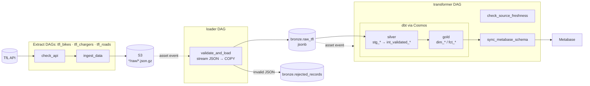

# TfL Data Pipeline

[](https://github.com/mahufa/london-transport-pipeline/actions/workflows/tests.yml)

ELT pipeline that loads Transport for London (TfL) data into a medallion-style PostgreSQL warehouse.

**Stack:** Python · Airflow · dbt · Cosmos · S3 / MinIO · PostgreSQL · Metabase

**Sources (TfL API):** `BikePoints` (dock availability), `Chargers` (EV charger availability), `Roads` (road disruptions).

## Architecture



* **Extract:** one DAG per source checks the API, then streams the response gzipped into S3.
* **Load (bronze):** streams each file through `ijson` and `COPY`s valid records into `bronze.raw_tfl`. Duplicates are removed in SQL, invalid records go to `bronze.rejected_records`, and reruns are idempotent.
* **Transform (dbt):** Cosmos renders each model as a run and test task. The models:
  * **Staging:** parse and type-check the payloads.
  * **Intermediate:** keep the valid rows.
  * **Gold:** dims are rebuilt each run, and facts load incrementally over a lookback window (`incremental_lookback`, 2 hours by default).
* **Data quality:**
  * **dbt tests:** uniqueness, not-null and fact-to-dim relationships.
  * **Freshness:** checked per source; it alerts but doesn't block the transform.
  * **Reject ratio:** a warning, alerted through Teams, when more than 10% of a batch is rejected.
* **Visualize:** after a successful transform, the Metabase schema is synced.

## Quickstart
Requires [Docker Desktop](https://www.docker.com/products/docker-desktop/). MinIO stands in for S3, and connections and Metabase are set up automatically.

```bash
docker compose up --build   # start
docker compose down -v      # stop and wipe all data
```

* Airflow: localhost:8080 (`admin`/`admin`)
* Metabase: localhost:3000 (`admin@example.com`/`MetabaseAdmin123`)

## Configuration
Connections and variables are `AIRFLOW_CONN_*` / `AIRFLOW_VAR_*` entries in `docker-compose.yaml`. To use real S3, replace `s3_conn`. To get Teams alerts, uncomment `AIRFLOW_CONN_TEAMS`.

## Testing
```bash
docker build --target test -t tfl-airflow:ci .
docker run --rm -v "$PWD:/opt/airflow/project" -w /opt/airflow/project -e PYTHONPATH=/opt/airflow/project \
  -e AIRFLOW__COSMOS__ENABLE_CACHE_DBT_LS=False tfl-airflow:ci \
  bash -c '$DBT_VENV/bin/dbt deps --project-dir dbt && python -m pytest -p no:cacheprovider tests'
```
* **Unit tests:** DAG integrity, JSON validation, `COPY` formatting and the asset-event helpers.
* **Integration tests:** dead-letter routing, deduplication and idempotent reruns of the bronze load. They need `DW_TEST_DSN` pointing to a **throwaway** database, because they drop the schemas.
* **CI:** GitHub Actions runs the full suite on every push.

## License
MIT
